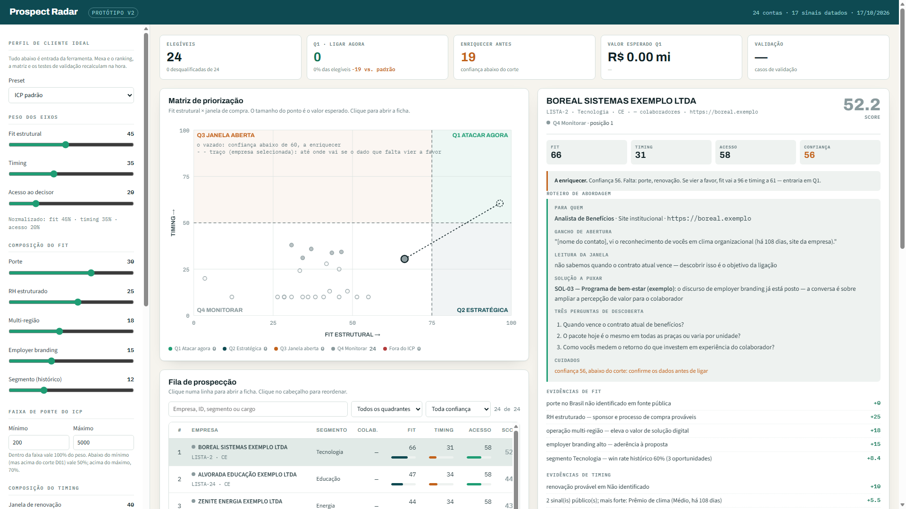

# Radar de prospecção com evidência

Protótipo acadêmico de prospecção B2B com IA: a partir de um perfil de cliente ideal (ICP), qualifica e prioriza empresas com **score, evidência com fonte, o que falta descobrir e canal institucional de contato**.

O diferencial é a rastreabilidade. Cada ponto do score mostra a frase e o link de onde veio, e o que não tem evidência aparece como "a enriquecer", com até onde a empresa sobe se o dado vier a favor.

Feito pelo Grupo 3 no ITA Challenge Sprint 2026: **Francisco Rizzo, Guilherme Matos, Adilson Batista e Roggers**.

> **Todos os dados deste repositório são fictícios.** Empresas, CNPJs, sites, trechos e histórico de vendas foram inventados por `dados-exemplo/gerar.py`. Os CNPJs começam por 99 e têm dígito verificador inválido, e os domínios terminam em `.exemplo`.



## Por que

Vendedor B2B passa pouco tempo vendendo. Na pesquisa State of Sales da Salesforce (5ª edição, 2023, mais de 7.700 profissionais de vendas em 38 países), só 28% da semana vai para a venda de fato. Boa parte do resto é pesquisa: descobrir se a empresa tem o perfil, se está num bom momento e com quem falar.

O problema não é falta de lead. É saber qual lead vale o esforço, e por quê. Ferramentas de dados B2B entregam bases grandes e um score, mas em geral não dizem de onde veio cada dado. O vendedor tem de acreditar no número.

Aqui a ideia é outra: **o vendedor não precisa acreditar no score, ele clica e confere.** Cada ponto vem com a frase e o link da fonte. O que falta aparece como lacuna declarada, com a pergunta certa para a primeira ligação, em vez de um chute.

## Por que IA, e só onde precisa

Onde regra simples resolve, é código: dados da Receita, score com os pesos do ICP, conferência dos trechos. A IA entra num lugar só, onde regra não alcança: ler o texto livre do site e dizer qual critério ele sustenta. "Mais de 1.000 funcionários em 7 estados" não cabe em if/else. E como a IA erra, o código confere cada trecho contra a página antes de aceitar.

## O que já medimos

Durante o desafio, o protótipo rodou com empresas reais (não incluídas aqui):

| Medida | Resultado | Limite |
|---|---|---|
| Lote de empresas reais | 306 empresas em cerca de 2 h, com o modelo rodando local, numa GPU | — |
| Precisão da leitura do site | 83% em 30 empresas sorteadas fora do ajuste (IC95 64% a 93%) | conferida por outra IA, não por pessoa |
| Trechos inventados pela IA | 27 de 27 barrados pela conferência | — |
| Canal de contato institucional | em todas as empresas do lote | — |
| Tempo do vendedor por conta | não medido | depende de um piloto com uso real |

E o que deu errado, cada caso virou correção com teste:

- uma função de sim/não respondia "sim" para tudo;
- a busca por uma sigla casou com uma empresa homônima de outro ramo, em outro estado;
- o radar leu o site de uma empresa com nome parecido. Hoje a busca do site usa cidade e ramo, e o código confere a página.

Nenhuma das três foi pega pelos testes automáticos. Todas foram achadas lendo os resultados.

## Como funciona

| Etapa | Como | IA? |
|---|---|---|
| Achar a empresa na Receita | busca no índice local dos dados abertos do CNPJ, com lista de candidatos para escolher | não |
| Achar o site oficial | busca na web e conferência no código de que a página cita o nome | só a busca |
| Ler o site | modelo local lê o texto livre e devolve o critério do ICP com o trecho literal | sim |
| Conferir o trecho | o código confere se o trecho existe mesmo na página; o que não existe é descartado | não |
| Pontuar | pesos do ICP, ponto a ponto, cada um com fonte | não |
| Mostrar | dossiê em HTML e o radar (matriz fit × timing, ficha, roteiro de abordagem) | não |

Regras de dados que o código segue:

- **Nome de pessoa nunca entra no dossiê.** O decisor entra por cargo e canal institucional. Telefone e e-mail pessoal são mascarados no trecho.
- **Sócios (QSA) nunca são guardados.**
- **Para a API externa vai só dado de empresa.** Empresário individual, MEI e pessoa física não vão.
- **Só o site da própria empresa é lido**, com agente identificado e respeitando o `robots.txt`.

## Rodar com os dados de exemplo

Testado com Python 3.14. Depende só de `openpyxl` (e `pytest` para a suíte).

```bash
pip install openpyxl pytest
python dados-exemplo/gerar.py      # gera os dados ficticios
python -m dossie                   # dossies e ranking em dados-exemplo/
python -m radar                    # radar em dados-exemplo/radar-AAAA-MM-DD.html
python -m pytest -q                # a suite
```

O painel roda com `python -m servidor` (em http://127.0.0.1:8770/) e já abre com as empresas de exemplo. Para analisar uma empresa nova na hora, ele precisa de três coisas fora deste repositório:

- o índice da Receita: Elasticsearch com os dados abertos do CNPJ, carregados por `receita_base.importar` (ver `infra/docker-compose.yml`);
- um modelo local compatível com a API do llama.cpp (variável `ITA_LLM_LOCAL`);
- opcionalmente, `ANTHROPIC_API_KEY`, para a busca do site oficial.

Para usar seus próprios dados no mesmo formato, aponte `RADAR_DADOS` para a pasta e `RADAR_BASE` para a planilha.

## Organização

| Arquivo | O que faz |
|---|---|
| `score.py` | score ponto a ponto, prioridade, confiança e "a enriquecer" |
| `icp/exemplo.json` | o ICP: pesos, faixa de porte e cargos de decisor |
| `extrator.py` | leitura do site pelo modelo local, com conferência do trecho |
| `resolucao.py`, `site_oficial.py` | nome → CNPJ → site oficial |
| `dossie.py` | junta Receita, site e lista; gera dossiê e ranking |
| `radar.py`, `radar/` | o radar visual |
| `servidor.py` | painel ao vivo |
| `receita_base/` | importação e índice dos dados abertos do CNPJ |

## Autores e créditos

- Grupo 3 do ITA Challenge Sprint 2026: Francisco Rizzo, Guilherme Matos, Adilson Batista e Roggers.
- O painel do radar (`radar/Prospect_Radar_V1.html`: motor, matriz fit × timing, ficha e roteiro) é do **Roggers**, publicado aqui com autorização dele. O `radar.py` só troca a entrada e aplica ajustes documentados no próprio arquivo.
- Dados abertos do CNPJ: Receita Federal do Brasil.

## Licença

MIT. Ver `LICENSE`.
